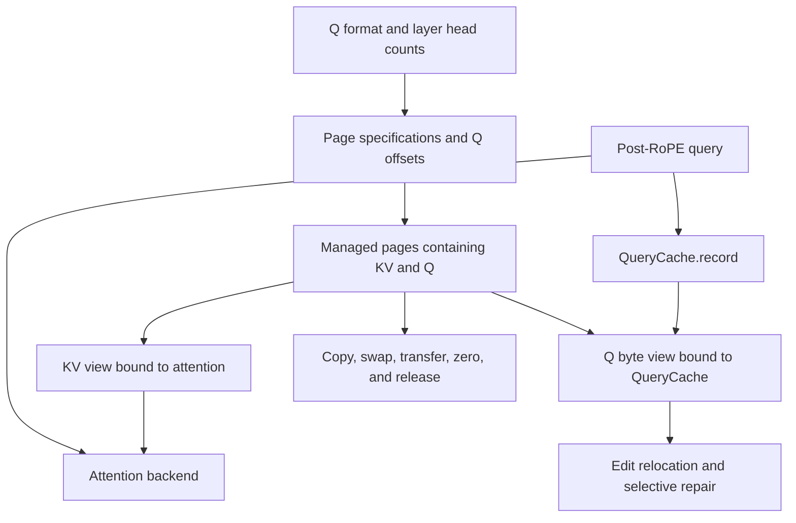

# Query storage in the paged KV cache

This record explains the Q-cache design, implementation, and validation from
commit `6ce2175207` (`Query token saving`). Source and existing documentation
were reviewed on November 21, 2026 at `ded40eeeb9` on `query-based-selection`.
The runtime results below are from the earlier implementation session. This
documentation update uses static inspection and does not rerun tests.

The original requirement was to retain each computed token's query alongside
its key and value, with independently selectable Q precision. Ordinary
attention must continue to read only K/V. Q must follow the same allocation,
sharing, copying, transfer, eviction, and release operations as its K/V.

Existing documents cover adjacent topics:

- [Query storage options](../features/quantization/quantized_kvcache.md#storing-decoder-queries)
  defines the public options, format sizes, and example memory costs.
- [KV cache editing](kv_cache_editing.md) describes the editor's public API,
  ownership, hash aliases, replacement prefill, suffix replay, and RoPE math.
- [Selective suffix repair](selective_suffix_repair.md) explains the first
  scoring consumer of stored Q, added after the original storage work.
  Its [plan](selective_suffix_repair_plan.md) and
  [verification report](selective_suffix_repair_verification.md) record that
  later implementation and its experiments.

## Design decisions

Q occupies extra space inside the managed KV pages. A separate allocation
would need its own mapping from token positions to pages and matching
updates for every cache lifecycle operation. Shared pages give Q the same
physical ownership as K/V and make existing whole-page operations carry Q.

Each attention layer receives a view restricted to its original K/V head
slots. The runner retains the full pages, and `QueryCache` retains a byte
view of the extra space. This keeps the backend's logical K/V interface
unchanged while allowing lifecycle operations to access all stored bytes.
The extra allocation reduces token capacity for a fixed memory budget.

The stored query is the tensor presented to decoder self-attention, after
any model normalization and RoPE. When the backend quantizes its query
input, Q storage uses the tensor from before that quantization. This makes
`q_cache_dtype` independent of both K/V precision and the backend's compute
format. Every query head is retained, including the extra query heads in
grouped-query and multi-query attention.

The default is `fp16`. This gives research consumers a stored query without
an extra option, at a substantial memory cost for models with many query
heads. `none` disables Q storage and restores the original K/V allocation.
The [cache configuration](../../vllm/config/cache.py) includes Q precision
in its configuration hash. [Engine arguments](../../vllm/engine/arg_utils.py)
expose the same choice through Python and `--q-cache-dtype`.

## Allocation and views



### Page geometry

The common logical page view is `[B, H, N, C]`. `B` indexes physical kernel
blocks, `H` indexes physical head slots, `N` indexes stored token positions,
and `C` is the content of one head slot. Its byte width depends on the
backend's K/V format. These physical head slots need not correspond one to
one with model KV heads.

[`AttentionSpec`](../../vllm/v1/kv_cache_interface.py) adds
`query_bytes_per_token`. Let `P` be this payload size, `C_bytes` the byte
width of one physical head slot, and `H_kv` the original physical head count.
The allocation uses:

```text
P = sum(query_head_count * encoded_query_head_bytes for each sharing layer)
extra_head_slots = ceil(P / C_bytes)
H = H_kv + extra_head_slots
```

Rounding applies to the combined payload. An individual query record can
cross a physical head-slot boundary. The extra slots contribute to page
size and therefore to the runner's memory budget and block count. Existing
page padding must still cover the enlarged page.

Both the [V1 runner](../../vllm/v1/worker/gpu_model_runner.py) and
[V2 attention setup](../../vllm/v1/worker/gpu/attn_utils.py) collect query
sizes after model setup. This includes modules registered late during setup.
`customize_attention_spec` first applies the backend's packing rules, then
adds the Q payload. Full-attention, sink-attention, and Reference Sliding
Window Attention specification merges preserve that field.

### Layer binding and shared K/V

[`get_query_cache_sizes`](../../vllm/v1/attention/ops/query_cache.py) assigns
a separate `byte_offset` to every layer that shares an owner's KV pages.
The owner's allocation reserves the sum of those records. Sharing K/V does
not imply that the layers compute the same Q.

[`bind_kv_cache_to_layers`](../../vllm/v1/worker/utils.py) resolves the layer
specification, including uniform-spec wrappers and KV-sharing owners.
`QueryCache.bind` retains the complete pages and creates the Q byte view.
It returns the K/V slice that becomes `layer.kv_cache`. `get_cache_pages`
returns the complete pages for operations that need both regions.

Byte indexing follows tensor strides rather than assuming one physical
layout. The format checks cover `LBHNC`, `LBNHC`, `LHBNC`, `BLHNC`, `BLNHC`,
and `BHLNC`. Packed NVFP4 requires a special view for its contiguous K/V
data and scale planes. Q starts after those planes within each block.
The NVFP4 check validates synthetic storage layout, not model execution.

## Encoding and access

[`QueryCache`](../../vllm/v1/attention/ops/query_cache.py) owns the encoding,
byte addressing, and decoding. FP16, BF16, and FP32 records contain cast
floating-point values. Quantized records contain a four-byte FP32 scale
followed by the encoded components. Each token and query head has its own
scale:

```text
scale = max(abs(query)) / limit
scale = 1 when the head is all zero
encoded components = encode(clamp(query / scale, -limit, limit))
```

The limits are 448 for FP8 E4M3FN, 127 for INT8, and 7 for INT4. Integer
formats use symmetric signed quantization and round to nearest with ties
to even. INT4 places two signed four-bit components in each byte, with the
first component in the low nibble. An odd final dimension leaves a padded
high nibble. `read` returns the selected floating-point dtype for raw
formats and dequantized FP32 values for quantized formats.

The CUDA writer fuses scale reduction, encoding, and byte scatter in one
Triton kernel for quantized Q. This avoids a sequence of small tensor
kernels on every attention call. FP8 conversion uses a software E4M3FN
encoder so Ampere GPUs can store FP8 without native conversion support.
The encoder handles subnormals and midpoint rounding. Floating-point
formats cast before byte scatter.

Each CUDA program writes one token and head. Addresses use 64-bit offsets,
masked tails protect the final components, and negative slot IDs skip
padded tokens. The CPU path uses PyTorch encoding and filters negative
slots before assignment. Empty mappings and writes before page binding
are no-ops, as required during profiling. The checks also cover strided
inputs, singleton records, all-zero heads, and odd head dimensions.

The access methods take physical slot IDs, not request token indices.
A consumer must resolve the request's block table and read only valid
computed positions. There is no separate Q validity index. Prefix hits
reuse existing Q. A path that skips a layer's query computation cannot
provide a fresh Q record for that skipped position.

At the current revision, `roundtrip_keys` represents keys in the Q format
for selective scoring. That later change extracted `_write_cuda` and
`_decode` so the scorer uses the writer's exact division and tie rounding.
It belongs to the selective-repair work, whose
[verification report](selective_suffix_repair_verification.md#correctness-checks)
explains the rounding discrepancy that prompted it.

## Forward execution

[`Attention.forward`](../../vllm/model_executor/layers/attention/attention.py)
preserves the original query when backend input quantization is active.
The unified attention operation obtains the layer's physical slot mapping
and calls `QueryCache.record` before the attention backend. It records the
preserved tensor when present, otherwise the normal query argument.

The same hook runs through the direct-call and opaque custom-operation
paths. The existing dependency that orders K/V updates before attention
is retained. Backends that integrate K/V writes can supply their slot
mapping through attention metadata. KV-sharing fast prefill aligns slots
with `logits_indices_padded` for the subset of computed queries.

Two fused decode paths in [Flint](../../vllm/models/flint/model.py) bypass
the unified operation. They explicitly call `record` after Q is formed.
Ordinary attention reads the K/V slice and does not fetch cached Q.

For decode context parallelism, `record` gathers local query heads across
the DCP group before writing the slots owned by that rank. The descriptor
reserves `local_query_heads * dcp_size` heads. Tensor-parallel ranks can
have different Q even when their KV heads are replicated. Q-bearing page
specifications therefore set `max_tp_shards=None` and must not inherit the
K/V-only replication or head-resharding assumptions.

## Cache lifecycle

Q shares physical pages and block ownership with K/V. Prefix-cache hits,
reference counts, copy-on-write, eviction, and page reuse consequently
refer to the same stored token history. Whole-page copies and host swaps
carry encoded Q, scales, and padding without decoding. Copy-on-write also
preserves every Q record belonging to layers that share the K/V owner.

The GPU block zeroer obtains full pages through `get_cache_pages`.
The [CPU runner](../../vllm/v1/worker/cpu_model_runner.py) does the same and
groups physical kernel blocks under the manager block being cleared.
Both paths account for manager blocks split into smaller kernel blocks.

Hybrid cache groups can reuse memory with different interpretations.
Bytes formerly used by Q can become K/V bytes in another group. Multiple
groups with Q therefore enable block zeroing alongside the existing
mixed-format and state-cache cases.

`clear_layer_kv_caches` clears the layer's K/V reference and calls
`QueryCache.unbind` to drop both the full-page and byte-view references.
The V1 cleanup path uses this shared helper, as V2 already did. Binding
a specification without Q also clears any stale Q binding.

## Behavior during cache edits

The static analysis of `LLM.edit_kv_cache` found that Q follows every
branch of the existing boolean suffix modes. The relevant worker code is
[`_prefill`, `_copy_tokens`, and `write_kv_cache_edit`](../../vllm/v1/worker/kv_cache_edit.py).

| Part of the edited context | Q handling |
| --- | --- |
| Unchanged whole prefix pages | Share the original pages and their Q. |
| Prefix fragment copied into the first private page | Copy encoded Q bytes at unchanged positions. |
| Replacement tokens | Run the model against the cached prefix and record fresh Q at the final positions. |
| Suffix with `recompute_suffix=True` | Run a separate suffix prefill and record fresh Q from the edited context. |
| Reused suffix with unchanged positions | Retain shared Q or copy its encoded bytes. |
| Reused suffix with shifted positions | Decode Q, apply the same RoPE relocation used for K, and encode it into the destination slots. |

`_prefill` supplies normal per-layer slot mappings in `ForwardContext`.
Although it requests eager execution with `skip_compiled=True`, the model
still reaches the attention Q-recording hook. Replacement and suffix
passes can each span multiple prefill chunks.

Relocating reused Q changes its rotary position, not its contextual
content. With `recompute_suffix=False`, that content still comes from the
original forward pass. Quantized relocation introduces another encoding
step, and repeated shifted edits can accumulate rounding error. Raw FP16
and BF16 relocation also rounds to their storage precision. The
[editor record](kv_cache_editing.md) explains the RoPE transform and the
source-page protection and publication rules.

Q precision does not relax the editor's existing requirements for dense,
unquantized K/V and supported one-dimensional RoPE. The editor also
rejects KV-sharing layers. Boolean modes still work with Q disabled.
`LLM.edit_kv_cache` returns token IDs and a cache salt, not Q arrays.

The later `recompute_suffix="selective"` mode requires bound Q. It scores
cached queries, starts with reused or relocated suffix records, and
overwrites selected tokens' Q through normal replay. The selection
algorithm and its validation remain in the selective-repair documents.

## Transfer and offload integration

Transports must preserve complete pages losslessly. Q bytes include packed
integers and FP32 scales even when the enclosing tensor has another dtype.
Treating those bytes as ordinary K/V numbers and requantizing them would
corrupt Q. The layer-save hook in
[`kv_transfer_utils.py`](../../vllm/model_executor/layers/attention/kv_transfer_utils.py)
passes `get_cache_pages(layer)` to connectors.

The original change updated the following integrations:

| Integration | Q-specific changes |
| --- | --- |
| [Example connector](../../vllm/distributed/kv_transfer/kv_connector/v1/example_connector.py) | Save and restore full pages. Include Q format, TP, and DCP in the namespace and rank in filenames. Use the tensor's kernel block size for indexing. |
| [Bundled LMCache adapter](../../vllm/distributed/kv_transfer/kv_connector/v1/lmcache_integration/vllm_v1_adapter.py) | Derive storage width from complete page specifications, include Q format in the model namespace, and use full pages when resolving layer caches. Require a uniform per-layer record width and a non-MLA layout. |
| [NIXL metadata](../../vllm/distributed/kv_transfer/kv_connector/v1/nixl/metadata.py) and [worker](../../vllm/distributed/kv_transfer/kv_connector/v1/nixl/base_worker.py) | Include Q format in compatibility metadata and require matching TP and DCP sizes for Q-bearing raw pages. |
| [Mooncake push](../../vllm/distributed/kv_transfer/kv_connector/v1/mooncake/mooncake_connector.py) | Carry Q format in metadata and reject incompatible formats or TP sizes. |
| [Mooncake store](../../vllm/distributed/kv_transfer/kv_connector/v1/mooncake/store/worker.py) | Namespace by Q format and TP. Disable shared storage based on K/V-only TP shards and use rank-local records. |
| [Native offload configuration](../../vllm/distributed/kv_transfer/kv_connector/v1/offloading/config.py) and [file mapping](../../vllm/v1/kv_offload/file_mapper.py) | Include Q format in storage identity. Use opaque rank-local pages where K/V-only topology-independent head mappings would be incorrect. |

These changes preserve Q in the affected full-page paths and reject
specific incompatible layouts. They do not establish compatibility with
every external connector implementation or compression option. The file
connector and native host-copy primitives were exercised locally. LMCache,
NIXL, and Mooncake services were not available for end-to-end validation.

## Earlier validation results

The original Q-cache work ran on one NVIDIA GeForce RTX 3060 with 12 GiB
of memory under WSL2. Commands used the repository's `.venv/bin/python`.
The model was Qwen2.5-1.5B-Instruct at snapshot
`989aa7980e4cf806f80c7fef2b1adb7bc71aa306`, with 28 layers, 12 query heads,
two KV heads, and a head dimension of 128.

### Storage and integration checks

The original query and editor unit suites passed all 15 methods. Nine
covered Q storage and its integration, and six covered the existing editor.
The relevant artifacts are the
[query tests](../../suffix_repair_test/test_query_cache.py),
[editor tests](../../suffix_repair_test/test_kv_cache_edit.py), and
[GPU edit check](../../suffix_repair_test/kv_cache_edit_gpu.py).

| Check | Recorded result and scope |
| --- | --- |
| Encoding and layout | All six Q formats passed on CPU and CUDA across all six physical layouts, including strided inputs, negative slots, zero heads, and odd dimensions. K/V and unused token bytes were preserved. |
| E4M3FN conversion | Finite positive and negative codes and adjacent midpoint ties matched the reference conversion on Ampere. |
| Sharing and copy-on-write | Separate Q offsets survived copies with two kernel pages per manager block. Updating one layer's destination record preserved the source and the sharing layer's record. |
| Host swap and zeroing | CUDA-to-host-to-CUDA block copies preserved quantized Q exactly. Clearing one full page preserved the other page. |
| File transport and cleanup | ExampleConnector restored full pages at different physical block IDs. Binding exposed only K/V to attention, and cleanup released Q references. |
| DCP and NVFP4 | Mocked DCP gathering preserved the gathered head order. A synthetic packed NVFP4 page preserved its K/V planes. These were not multi-GPU or NVFP4 model runs. |
| Static checks | Ruff lint and formatting, Python compilation, CLI option inspection, and `git diff --check` passed during implementation. |

The detailed GPU script compared captured prefill and decode queries with
stored Q. It also filled cached Q with invalid byte patterns and confirmed
that ordinary generation retained its token IDs and log probabilities.
This directly checked that ordinary attention did not consume cached Q.

The edit scenario changed a 95-token source into 162 tokens, then 133.
The 70-token replacement and 73-token suffix each crossed the 64-token
prefill budget. Checks covered all 28 layers, source immutability, copied
prefix bytes, shifted Q against an independent RoPE reference, and fresh
suffix Q against a reference forward. V1 passed with FP16, INT4, and
disabled Q. V2 passed with FP16, FP8, and INT4 Q.

Those model runs used eager FP16 execution, Triton attention, 16-token
blocks, a maximum length of 256, four sequences, and GPU memory utilization
of 0.7. The detailed script's cache reservation increased from 32 MiB to
128 MiB to accommodate Q. Quantized relocation checks used format-specific
error bounds rather than requiring equality with unquantized Q.

### Compiled generation parity

Separate compiled smoke checks compared enabled and disabled Q with the
same backend and K/V precision. Cold and prefix-hit token IDs and log
probabilities matched between each enabled/disabled pair.

| Attention backend | K/V format | Q pair | Generated token IDs |
| --- | --- | --- | --- |
| FlashAttention | `auto` | `fp8` and `none` | `[1, 323, 324, 325, 326]` |
| Triton attention | `int8_per_token_head` | `int8` and `none` | `[1, 311, 312, 313, 314]` |

These probes used prompt IDs `list(range(300, 335))` and
`SamplingParams(max_tokens=5, temperature=0, ignore_eos=True, logprobs=1)`.
Each configuration generated the same prompt twice, with zero then 32
cached tokens. The LLM settings were FP16 weights, maximum length 96,
two sequences, a 64-token batch budget, 16-token blocks, 48 MiB of cache,
prefix caching enabled, and GPU memory utilization of 0.65. Compilation
and CUDA graphs used the default configuration, with eager mode disabled.
The probes used offline model loading and an in-process engine through
`HF_HUB_OFFLINE=1` and `VLLM_ENABLE_V1_MULTIPROCESSING=0`.

The equality claim compares Q settings within the same backend and cache
condition. Different backends and cold versus prefix-hit forward shapes
can produce different floating-point results.

### Query-write timing

[`bench_query_cache.py`](../../suffix_repair_test/bench_query_cache.py)
times one layer's Q write with 12 heads of dimension 128. The experiment
used seed 7, random FP16 input, randomly selected slots from 1,024 positions,
16-token pages, eight warm-up iterations, and 40 timed iterations inside
a CUDA graph. The benchmark requested CUPTI, but the local installation
fell back to CUDA events. The final recorded run reported these medians:

| Tokens | FP16, microseconds | FP8, microseconds | INT8, microseconds | INT4, microseconds |
| ---: | ---: | ---: | ---: | ---: |
| 1 | 4.96 | 5.68 | 2.11 | 3.49 |
| 32 | 5.96 | 4.29 | 2.66 | 3.48 |
| 512 | 13.93 | 22.94 | 21.81 | 23.76 |

These timings exclude model forward work, Q decoding, RoPE relocation,
and Python dispatch. Small-launch timings varied across runs. They are
local measurements of write cost, not end-to-end throughput estimates.

### Reproduction artifacts

The original results belong to `6ce2175207`. The current files also include
later selective-repair changes. From the repository root, the focused
storage checks and write benchmark are invoked with:

```bash
.venv/bin/python -m unittest -v suffix_repair_test.test_query_cache \
    suffix_repair_test.test_kv_cache_edit
.venv/bin/python -m suffix_repair_test.bench_query_cache
```

The [editor record](kv_cache_editing.md) provides the model
snapshot path and GPU-script commands. Its `--q-cache-dtype` argument
selects the Q format. The original model matrix was:

| `VLLM_USE_V2_MODEL_RUNNER` | `--q-cache-dtype` values exercised |
| --- | --- |
| `0` | `fp16`, `int4`, `none` |
| `1` | `fp16`, `fp8`, `int4` |

The compiled probes were ad hoc runs with the configuration recorded
above. The repository retains the eager integration script and write
benchmark, rather than a separate compiled-parity script. Later all-format
model checks and real two-process scoring checks are documented in the
[selective-repair verification report](selective_suffix_repair_verification.md).

## Validation limits

The storage work covers ordinary decoder self-attention. Encoder and
cross-attention K/V and specialized compressed MLA caches have no new
per-token Q record. Q exists only for queries actually computed and written
through an integrated path. Cache edits that reuse tokens retain their
original contextual history, subject to the position adjustment above.

End-to-end multi-GPU Q storage, DCP inference, remote connector services,
ROCm execution, CPU model inference, and real packed NVFP4 model execution
were not validated in the original work. Synthetic page tests and mocked
collectives establish narrower properties. Future transports must retain
the full encoded record and respect the format and topology constraints.
